<!--
  Every image here is drawn by scripts/render_cards.py and refreshed daily by
  .github/workflows/update-cards.yml. Change texts in the script, not here.
  Cards that share a row must stay on ONE line with no spaces between tags.
-->

<a href="https://richardtjustke.tech"></a>

<a href="https://richardtjustke.tech/about"></a>

<a href="https://github.com/RichardtJustke"></a>


<a href="https://www.ketsu.dev/"></a><a href="https://github.com/RichardtJustke/folio"></a><a href="https://richardtjustke.tech/blog"></a>

<a href="https://github.com/RichardtJustke/folio"></a><a href="https://richardtjustke.tech/work"></a><a href="https://github.com/RichardtJustke/justke-cli"></a>


<a href="https://richardtjustke.tech/contact"></a>

<a href="https://www.linkedin.com/in/rjustke/"></a>

<a href="https://github.com/RichardtJustke"></a><a href="https://www.ketsu.dev/"></a>

